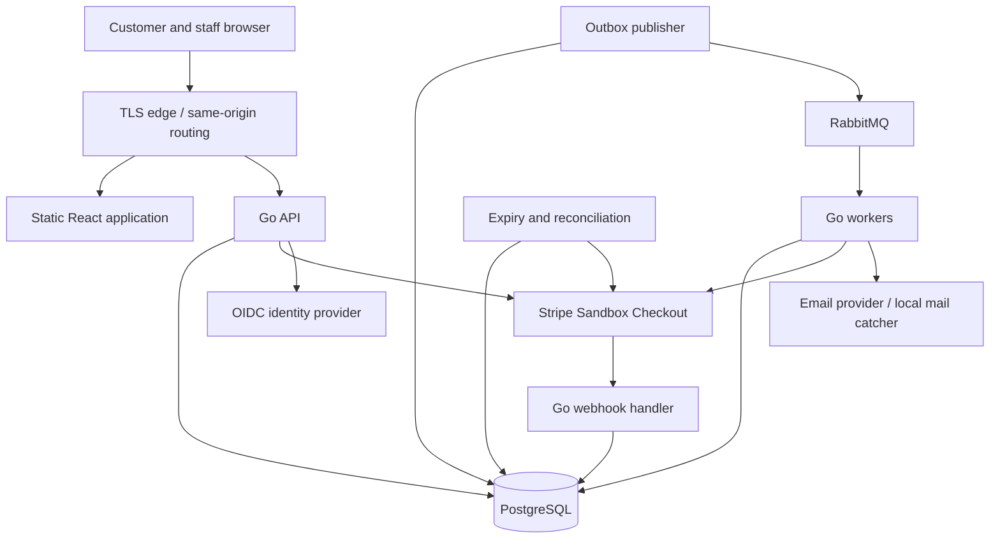

# Technical plan: Concert Ticketing

Status: proposed implementation baseline  
Date: 2026-10-22  
Requirements: [PRD](PRD.md)

## 1. Architecture and boundaries

Use a monorepo containing a modular Go backend and a React frontend. API and background process roles build and deploy separately from the same versioned backend. PostgreSQL owns transactional business state. RabbitMQ transports asynchronous work with at-least-once processing and idempotent durable effects.



Domain modules: catalog, booking, payment, ticketing, notification, and operations. Modules own their tables and mutation methods. A booking application service coordinates the transaction for payment confirmation and seat ownership; asynchronous events trigger ticket issuance and notification after that commit.

Do not split databases or introduce network calls between these modules initially. Avoid a generic repository framework; introduce narrow interfaces at external boundaries and where tests need substitutable behavior.

## 2. Stack and rationale

| Concern | Selection | Application |
| --- | --- | --- |
| Backend | Supported stable Go toolchain | API, workers, maintenance, simulator |
| HTTP | `net/http` and `ServeMux` | Routing, explicit middleware, request deadlines |
| Contracts | OpenAPI and versioned JSON event schemas | Generate frontend API types; validate contract compatibility |
| Database | Supported PostgreSQL release | Inventory, bookings, money records, sessions, outbox, inbox |
| Queries | `pgx/v5`, `pgxpool`, and `sqlc` | Parameterized handwritten SQL with generated typed methods |
| Migrations | Goose SQL migrations | Single controlled migration job per release |
| Messaging | Supported RabbitMQ release and `amqp091-go` | Durable topic/direct exchanges, quorum queues in resilience/deployed environments |
| Frontend | React, TypeScript, Vite, React Router, TanStack Query | Customer checkout and staff interface; SVG seat map |
| Payments | Stripe Checkout Sandbox, official `stripe-go` SDK, local Go simulator | Hosted card checkout and deterministic failure scenarios |
| Identity | OIDC authorization code flow with PKCE | Provider selected before identity milestone; local provider fixture/profile |
| Sessions | PostgreSQL-backed opaque sessions | Secure cookie, server-side revocation, no browser token storage |
| Logging | `log/slog` JSON | Booking, attempt, event, and trace correlation |
| Telemetry | OpenTelemetry, Collector, Prometheus, Grafana, Tempo | Traces, metrics, alerts; optional Loki for centralized logs |
| Tests | Go testing/race detector, Testcontainers, Playwright, k6 | Rules, concurrency, real dependencies, browser paths, load |
| Local runtime | Docker Compose | Core, observability, and resilience profiles |
| Deployment | OCI images and infrastructure as code | Managed PostgreSQL, managed RabbitMQ, independent container roles |
| CI | GitHub Actions | Checks, image builds, integration tests, contract validation |

Go fits concurrent HTTP and worker workloads, explicit error handling, bounded cancellation, profiling, and small container artifacts. Goroutines are not admission control: bound worker concurrency, database pools, and provider requests. Database transactions enforce correctness across processes.

Pin exact supported versions and container digests during bootstrap, record them in toolchain files/lockfiles, and establish an upgrade cadence. This plan does not assume a particular latest release.

## 3. Repository layout

```text
concert-ticketing/
  backend/
    cmd/{api,worker,maintenance,payment-simulator}/
    internal/{catalog,booking,payment,ticketing,notification,operations}/
    internal/platform/{database,messaging,httpserver,identity,telemetry}/
    migrations/
    sqlc.yaml
    go.mod
  frontend/
    src/
    package.json
  contracts/{openapi,events}/
  deploy/{compose,infrastructure}/
  tests/{e2e,load,failure}/
  docs/{decisions,runbooks,reports}/
```

Keep Go-generated query code inside its owning module. Frontend and backend each retain native tooling; add root task commands for common workflows. Path-based CI must also run dependent checks when contracts, migrations, or deployment configuration change.

## 4. Persistence model

| Entity | Important fields and constraints |
| --- | --- |
| Users and roles | Stable internal user ID; unique OIDC issuer/subject; staff roles |
| Sessions | Hashed session token, user, expiry, revocation metadata |
| Concerts and performances | Venue, start time, timezone, sale window, pause state, currency |
| Venue seats | Stable seat ID, section, row, label, layout coordinates |
| Performance seats | Primary key `(performance_id, seat_id)`; availability state, owning booking, price |
| Bookings | Customer, performance, state, `expires_at`, price snapshot, currency, version |
| Booking seats | Immutable historical seat/price lines; unique `(booking_id, seat_id)` |
| Payment attempts | Booking, provider, stable operation key, external IDs, amount, currency, state |
| Refunds | Payment, amount, reason, operation key, provider ID, status and next reconciliation time |
| Tickets | Unique booking-seat reference; credential hash, state; protected credential material for retrieval |
| Admissions | Unique ticket ID, performance, scanner, accepted timestamp |
| Outbox | Event ID, aggregate/version, destination, JSON payload, claim lease, attempts, `available_at`, publish state |
| Webhook inbox | Unique provider/event ID, protected payload, received time, processing state |
| Consumer inbox | Unique `(consumer_name, event_id)` committed with business effects |
| Idempotency records | User/operation/key scope, canonical request hash, result reference, retention metadata |
| Audit log | Actor, action, target, reason, before/after references, timestamp |

Use UTC `timestamptz` for timestamps, integer minor units for amounts, foreign keys, positive/nonnegative checks as appropriate, and unique provider identifiers. Never use floating-point money.

Maintain one current seat owner in `performance_seats`; historical `booking_seats` rows do not establish ownership. Application transactions and constraints jointly protect consistency. Store money state separately from booking and ticket states.

State transitions:

- Booking: `HELD -> CONFIRMED | EXPIRED | CANCELLED`; `CONFIRMED -> REFUND_PENDING -> REFUNDED`. Refund exceptions remain explicitly tracked without restoring tickets automatically.
- Payment attempt: `CREATING -> PENDING | UNKNOWN | SUCCEEDED | FAILED`; reconciliation resolves `UNKNOWN`. A payment may succeed after its booking expires; record the financial fact without reviving the booking.
- Refund: `REQUESTED -> SUBMITTING -> PENDING | UNKNOWN -> SUCCEEDED | FAILED`, with controlled retry transitions.
- Ticket: `ISSUED -> USED | VOIDED`.

Persist append-only transition/audit history for support. This is a relational state model with history, not event sourcing.

## 5. Transactions and concurrency

### 5.1 Atomic reservation

1. Validate authentication, seat count, distinct seats, and request idempotency.
2. In one transaction, lock the performance for a sales-state check and coordinate the user's per-performance purchase-limit record.
3. Lock all requested performance-seat rows in stable seat-ID order, with a bounded lock timeout. If reclaiming an expired owner, first acquire affected booking locks using the common lock order, then re-read ownership.
4. Check database time, sale state, ownership, and account limits; create the complete booking and all seat lines.
5. Assign ownership, insert outbox events and idempotency result, and commit. Any conflict rolls back everything.

Use a shared lock for the performance sale-state read so buyers do not serialize on one exclusive performance lock. Sales pause takes the conflicting lock. Reserve a stable per-user/per-performance row for quota coordination; create it safely using a unique key.

Define and test one global lock ordering before implementation: performance, user quota, bookings in ID order, then performance seats in ID order. Discovering an additional booking after locking seats requires rolling back and retrying with the complete lock set. Do not introduce an inverse lock path in the expiry sweeper.

Begin with short `READ COMMITTED` transactions, explicit row locks, and guarded updates. Retry deadlocks/serialization failures only with bounded attempts and idempotent inputs. Use PostgreSQL wall-clock evaluation after lock acquisition for expiry checks; transaction-start timestamps can become stale while waiting.

### 5.2 Confirmation and expiry

Confirmation locks the booking, verifies expected payment facts, reads current database time, and checks seat ownership. If still `HELD` and unexpired, atomically mark the booking confirmed, seats sold, and payment recorded; insert the confirmation event. If expired/cancelled or already paid by another attempt, atomically record the payment and a unique refund obligation.

The expiry job processes due bookings in bounded batches with `FOR UPDATE SKIP LOCKED`, releases only seats still owned by that booking, updates state, and inserts an expire-checkout task. Seat availability requests never authorize an expired booking merely because the sweeper has not run.

`SKIP LOCKED` is suitable for background batch claiming, not for silently dropping requested customer seats. No HTTP/provider call occurs while holding inventory locks.

### 5.3 Refunds and admission

Accept a permitted full-order refund in a transaction that locks the booking and affected tickets, rejects already-used tickets, voids tickets, and inserts one refund operation and an outbox task. Admission and refund acquisition use a consistent booking/ticket lock order. A pending or failed refund keeps tickets void and inventory unavailable until an explicit audited resolution.

Ticket issuance locks the booking and rechecks that it is still confirmed before creating tickets. This serializes issuance with refunds, including a refund accepted before the issuance worker runs. Replayed confirmation events must not issue tickets for refund-pending or refunded bookings.

Admission validates performance and credential, then atomically inserts the unique admission record and marks the ticket used. A second scan returns the existing admission outcome. Admission checks booking eligibility as well as ticket state.

## 6. Stripe and payment lifecycle

Use Stripe Sandbox hosted Checkout, one-time card payments, automatic capture, and an explicitly pinned Stripe API version. Confirm account access and currency support before building the integration. Live onboarding is separate.

1. Persist a payment attempt and stable idempotency key before calling Stripe. The API may create the session synchronously outside the booking transaction so it can return a checkout URL immediately.
2. Use server-owned line items and identifiers. Do not enable adjustable quantities, automatic taxes, promotion codes, or unmodeled price changes.
3. Attach booking/attempt references in metadata and persist the returned session/payment identifiers. A callback can arrive before the API saves the response: correlate to the persisted attempt and validate provider state.
4. On timeout, leave the attempt unresolved. Repeat only the same supported idempotent provider operation or reconcile it; do not create a new charge blindly.
5. Verify webhook signatures over the original bounded body. Persist each accepted event and a processing task in one transaction before returning `2xx`; return a failure if persistence fails.
6. A worker retrieves authoritative payment/session state when needed and runs the confirmation transaction. A checkout completion or browser redirect alone does not prove successful payment.
7. Reconcile missing/uncertain attempts, successful payments without bookings, and pending refunds. Use per-record leases and bounded polling/backoff.

The five-minute local hold is not implemented by assuming Stripe accepts a five-minute `expires_at`. Verify provider expiration limits during the payment spike; use a supported provider deadline and explicitly expire open sessions when the local hold expires. That call can fail or race with completion. The database deadline and late-payment refund policy remain authoritative.

Do not extend a hold because session creation is slow. Reject creation if too little useful hold time remains; if creation completes after local expiry, queue expiration and do not return a usable checkout action.

Retain operation keys and request data long enough for retries and investigation. Provider idempotency retention is finite: after that window, require provider lookup/manual investigation before repeating an uncertain create/refund request.

The simulator implements create, retrieve, expire, refund, and signed-event delivery with selectable timeout-after-accept, duplicate, out-of-order, missing-event, and late-success cases. It is used for load testing; Stripe Sandbox is used for integration checks.

## 7. RabbitMQ design

Topology is versioned alongside deployment configuration. Initial events exchange: durable topic `concert.events.v1`. Tasks use a durable direct exchange `concert.tasks.v1`. Use bounded, module-level queues rather than one queue per concert or booking.

| Queue / consumer | Inputs | Durable effect |
| --- | --- | --- |
| `payment.webhooks.v1` | Process persisted webhook task | Verified payment transition or refund obligation |
| `payment.refunds.v1` | Refund requested | Provider refund and reconciled local status |
| `payment.expiration.v1` | Expire checkout requested | Close an open provider checkout when possible |
| `ticketing.issue.v1` | `booking.confirmed.v1` | One ticket per confirmed booking seat |
| `notification.delivery.v1` | `tickets.issued.v1`, refund updates | Delivery attempt referencing existing artifacts |

Events carry `event_id`, `event_type`, `schema_version`, `occurred_at`, `aggregate_id`, `aggregate_version`, `correlation_id`, `causation_id`, trace context, and a minimal payload. Never include card data, full ticket credentials, or unnecessary PII.

Outbox publishing:

- Claim due rows with short transactions and expiring leases; publish outside database locks.
- Use persistent messages, publisher confirms, and mandatory routing. Handle returned unroutable messages as failures even when a publish is confirmed.
- Mark published only after acceptance and route checks. A crash after broker acceptance but before marking published can republish the event.
- A confirmation proves broker acceptance, not downstream processing. Do not claim end-to-end exactly-once delivery.

Consumer processing:

- Use manual acknowledgements, initially prefetch 16 and concurrency 8 per role; tune from measured database/provider capacity.
- Commit inbox deduplication, guarded state changes, and subsequent outbox events together, then acknowledge.
- External provider operations use persisted operation records and provider idempotency. Notification delivery may duplicate if its provider lacks idempotency; stable ticket issuance remains protected.
- Ignore already-applied transitions; detect stale versions and reconcile rather than assuming queue order.
- Configure and test connection/channel recovery, topology availability, heartbeat, confirms, consumer re-registration, and shutdown against the pinned client version. Use the client's supported recovery features where suitable.

Retries and quarantine:

- On a transient failure, transactionally persist the retry schedule/task and its attempt count before acknowledging the original. Use the outbox `available_at` as a durable scheduler with exponential backoff and jitter; do not immediately requeue in a hot loop.
- Initial retry policy: up to eight attempts with a 15-minute delay cap; operation-specific reconciliation can continue after task retry exhaustion.
- Quarantine exhausted, invalid, or unsupported messages in a durable failed-message store and corresponding dead-letter queue. Avoid retrying business conflicts as infrastructure errors.
- Use quorum queues for deployed/resilience environments; configure delivery limits, queue bounds, overflow rejection, and at-least-once dead-letter transfer where required. Do not rely on default dead-letter safety settings.
- Replay preserves the original event identity for unprocessed work. Re-executing completed business work requires an explicit audited repair operation, not deleting inbox rows.

## 8. API and frontend contracts

Initial endpoints:

| Endpoint | Purpose |
| --- | --- |
| `GET /api/v1/performances` | Browse performances |
| `GET /api/v1/performances/{id}/seats` | Seat layout and estimated availability |
| `POST /api/v1/reservations` | Atomic hold; requires idempotency key |
| `GET /api/v1/bookings/{id}` | Owned booking, payment summary, server time and deadline |
| `POST /api/v1/bookings/{id}/checkout` | Create/recover checkout attempt; requires idempotency key |
| `POST /api/v1/bookings/{id}/cancel` | Cancel unpaid hold |
| `GET /api/v1/bookings/{id}/tickets` | Retrieve existing authorized tickets |
| `POST /api/v1/webhooks/stripe` | Signed provider webhook, exempt from browser CSRF |
| `POST /api/v1/admissions` | Authorized online scan |
| `/api/v1/staff/...` | Search, pause sales, refunds, delivery retries, failed-work inspection/replay |

Use a documented error shape with stable codes and correlation ID. Distinguish validation, ownership, conflict, expired, rate-limited, pending, and dependency-unavailable outcomes. Unknown booking IDs must not leak ownership. Put sensitive scan credentials in request bodies, not URLs.

Scope idempotency by authenticated user and operation; compare canonical request hashes. Concurrent duplicates coordinate through a unique record; retain completed booking/payment keys through the operational support window and document expiry behavior.

The frontend polls booking state with backoff, pauses unnecessary background polling, and renders countdowns from server time. API state, not client countdown or checkout redirect parameters, decides success. Accessibility includes a keyboard/list alternative to the SVG seat map.

## 9. Security and data handling

- Use OIDC authorization code flow with state, nonce, PKCE, validated issuer/audience, and server-side sessions; select the provider before milestone 1. Enforce staff MFA through provider policy.
- Use Secure, HttpOnly, SameSite cookies, session rotation, logout/revocation, and CSRF protection for cookie-authenticated mutations.
- Enforce booking ownership and role authorization at service boundaries. Restrict refund/replay permissions and record actor/reason.
- Bound HTTP bodies, headers, timeouts, SQL pool size, worker concurrency, and external request budgets. Rate-limit at the edge and API.
- Use TLS, private database/broker networking, least-privilege database/broker users, and a secret manager in deployed environments. Never commit secrets or sandbox keys.
- Keep ticket verification hashes; protect recoverable ticket material through encrypted storage with managed keys. Restrict retrieval to owners/staff and keep credentials out of logs, analytics, URLs, and tracing attributes.
- Persist only necessary webhook fields; encrypt/restrict retained raw payloads. Define retention for PII, payment audit records, inbox/outbox, failed payloads, and idempotency records before public use.
- Keep audit data append-only to application roles where practical. Record privileged changes without copying secrets into before/after payloads.

Account quotas alone are not bot protection. A public sale additionally requires abuse monitoring and capacity-based admission decisions.

## 10. Observability and operational controls

Emit structured logs and propagate trace context through outbox events. Use booking/payment IDs in logs and traces, not unbounded metric labels. Instrument APIs, pool waits, SQL transactions, provider calls, publisher confirms, consumers, and maintenance jobs.

Dashboards and alerts:

- Reservation p95/p99, unexpected failures, conflicts, lock waits, pool saturation, and active holds.
- Oldest unpublished outbox row, publish failures/returns, queue depth/age, redeliveries, consumer saturation, and quarantined work.
- Oldest uncertain payment/refund, callback processing age, reconciliation heartbeat, and unmatched successful charges.
- Ticket issuance age, notification failures, admission latency, and duplicate-scan rate.
- Broker disk/memory alarms, quorum health, database capacity, backup health, and certificate/secret rotation.

Do not fail API liveness merely because RabbitMQ is unavailable. Readiness depends on the role: the API requires its authoritative database; a consumer requires usable messaging/database connectivity. Checkout additionally gates on provider state and bounded backlog age. Stop admitting new payable holds when durable backlog age exceeds the agreed operational threshold; continue status, callbacks, and refunds.

Required runbooks: sales pause, payment uncertainty, late-payment refunds, failed refund, dead-letter replay, broker outage, database failover/restore, leaked ticket credential, and rollback during checkout.

## 11. Runtime and deployment

Local Compose profiles:

- Core: PostgreSQL, one RabbitMQ node, local mail catcher, identity fixture/provider, optional simulator.
- Observability: Collector, Prometheus, Grafana, Tempo, optional Loki.
- Resilience: three RabbitMQ nodes with quorum queues. Local nodes share one physical failure domain; this does not demonstrate availability-zone resilience.

Deployed baseline:

- Same-origin TLS edge routing to static frontend and at least two API replicas.
- Separate worker roles and maintenance instances, coordinated through durable claims/leases.
- Managed PostgreSQL with HA, encrypted storage, automated backups, and point-in-time recovery.
- A three-node RabbitMQ cluster across failure domains, with tested queue placement and supported policies.
- Managed identity/secrets and centralized telemetry. Private access to broker management tools.

Cloud provider, instance sizes, region, and budget are unresolved. Select them through a short deployment decision before provisioning. A smaller development deployment must explicitly state which resilience properties it cannot demonstrate. Kubernetes is not required for this release.

CI checks formatting, static analysis, vulnerability scanning, generated-code/contract drift, unit tests, integration tests, and image builds. Run race tests for concurrency-sensitive packages, browser tests for core journeys, and scheduled/manual load and recovery suites.

Use expand/migrate/contract schema changes; keep event readers compatible across a rolling deployment. Run migrations once as a controlled job. Never automatically perform destructive rollback migrations. Stop intake, finish bounded work, and leave unacknowledged/incomplete work recoverable during shutdown.

Restore PostgreSQL into an isolated environment, reconcile with provider state, and reconstruct missing ticket/refund tasks from authoritative tables. Outbox/inbox records restored together can still reflect an older external reality: provider reconciliation is mandatory. Pause venue admissions after a disaster until restored ticket/admission state is reconciled; the database RPO does not guarantee preservation of every scan.

## 12. Implementation milestones and gates

| Milestone | Deliverables | Exit gate |
| --- | --- | --- |
| 0: Bootstrap and decisions | Repository tooling, pinned versions, Compose, CI, identity choice, Stripe access/expiration spike, initial OpenAPI and schema | One command starts core dependencies; migration and integration-test smoke checks pass |
| 1: Correct booking | Catalog seed, identity/session flow, quota coordination, atomic holds, idempotency, expiration, customer seat selection | AC-01/02 and relevant ownership tests pass; locking strategy demonstrated against PostgreSQL |
| 2: Reliable payment | Attempt records, Stripe adapter, simulator, webhook inbox, outbox, RabbitMQ roles, reconciliation, refunds | AC-03/04/05/06/07/10 pass, including timeout-after-accept and additional successful charge |
| 3: Tickets and staff tools | Issuance/retrieval, notifications, online scanning, staff search/refunds/replay, audit history | AC-08/09/13 pass, including admission/refund races |
| 4: Operational release | Infrastructure, dashboards, alert drills, load reports, compatible deployment, backup restore, runbooks | AC-11/12 and all PRD nonfunctional targets measured with remaining gaps recorded |
| 5: Advanced work | Waiting room, waitlist, cancellation batches | Separate PRDs and acceptance tests; no regressions in core gates |

Do not estimate calendar duration until team availability, hosting budget, and identity/provider access are known. Each milestone should produce a reviewable working increment.

## 13. Verification strategy

Map tests to the PRD acceptance IDs. Test business invariants using real PostgreSQL transactions and real RabbitMQ consumers; mock only external boundaries where useful. Include randomized concurrent seat requests and verify database invariants after each run.

Load cases: ordinary browsing/checkout, a single hot performance, same-seat contention, distributed-seat purchases, sudden sale opening, long-running worker load, and recovery after outages. Separate expected conflicts from successful throughput and infrastructure failures.

Failure harness cases: terminate processes before/after commit and acknowledgement; disconnect broker during publishing; duplicate/reorder callbacks; drop provider responses; fail refund submission; delay notifications; restart maintenance during a batch; and interrupt deployment. Record exact commands, seeds, versions, resource limits, results, and unresolved limitations in `docs/reports/`.

Acceptance requires zero invariant violations plus the measured latency/recovery targets, not merely a high request count. Run a sandbox-provider compatibility suite separately from simulator-based load tests.

## 14. Advanced extensions

1. Waiting room with an explicit fairness policy, signed short-lived admission tokens, reconnect support, and bounded admission based on measured booking capacity. RabbitMQ is not the customer waiting-room state store.
2. Waitlist offers that use the existing atomic seat allocator, expiring offers, and account limits.
3. Resumable concert cancellation that pauses sales, voids tickets, batches refund obligations, and tracks completion across restarts.
4. Capacity-aware scaling using queue age, database/provider budgets, and sustained load tests. Additional consumers must not overwhelm downstream systems.

Add Redis only if measured cache or shared-admission requirements justify it. Seat ownership remains in PostgreSQL.

## 15. References and implementation checks

External behavior must be verified against pinned versions during implementation; links are design inputs, not guarantees about untested code.

- [Go cancellation](https://go.dev/doc/database/cancel-operations) and [HTTP routing](https://go.dev/doc/go1.22).
- [sqlc](https://docs.sqlc.dev/), [pgx](https://github.com/jackc/pgx), and [Goose](https://github.com/pressly/goose).
- [PostgreSQL explicit locking](https://www.postgresql.org/docs/current/explicit-locking.html).
- [RabbitMQ reliability](https://www.rabbitmq.com/docs/reliability), [confirms](https://www.rabbitmq.com/docs/confirms), [quorum queues](https://www.rabbitmq.com/docs/quorum-queues), and [Go client](https://github.com/rabbitmq/amqp091-go).
- [Stripe sandboxes](https://docs.stripe.com/sandboxes), [testing](https://docs.stripe.com/testing), [webhooks](https://docs.stripe.com/webhooks), [idempotency](https://docs.stripe.com/api/idempotent_requests), [Checkout expiration](https://docs.stripe.com/api/checkout/sessions/expire), and [limited inventory](https://docs.stripe.com/payments/checkout/managing-limited-inventory).
- [OpenTelemetry Go](https://opentelemetry.io/docs/languages/go/), [Testcontainers Go](https://golang.testcontainers.org/), and [k6](https://grafana.com/docs/k6/latest/using-k6/).
